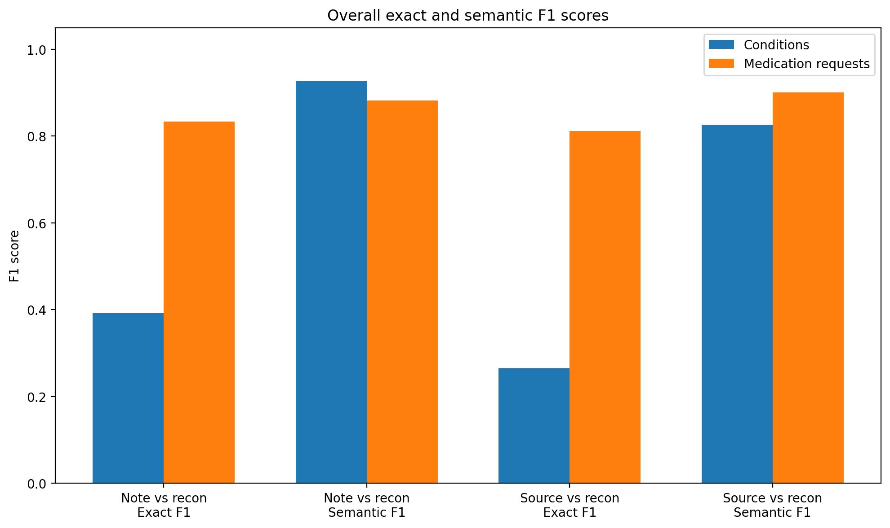

# Projet BUPA

## Présentation

Ce projet étudie un pipeline de reconstruction structurée de données médicales à partir de notes cliniques générées depuis des bundles FHIR synthétiques (Synthea), avec le modèle **MedGemma** (`google/medgemma-4b-it`).

L'idée générale :

1. partir d'un dossier patient structuré au format FHIR
2. filtrer l'information utile
3. construire une source structurée de référence (`gold_source`)
4. générer une note clinique non structurée
5. reconstruire une structure à partir de cette note
6. évaluer la qualité de la reconstruction
7. vérifier la cohérence et analyser les erreurs

Le projet se concentre sur deux types d'information : les **conditions** et les **medication requests**.

**FHIR filtered → gold source → note générée → reconstruction → scoring → vérification → analyse des erreurs**

## Structure du dépôt

```text
bupa/
├── README.md
├── requirements.txt
├── .env.example              # modèle du fichier .env (HF_TOKEN)
├── config/
│   └── settings.py           # tous les paramètres : chemins, modèle, plafonds, tokens, températures
├── src/                      # le code du pipeline, une étape par module
│   ├── utils.py              # normalisation de texte, lecture/écriture JSON
│   ├── fhir.py               # 1-3. téléchargement Synthea, préfiltrage, extraction patient, échantillon
│   ├── llm.py                # MedGemma, authentification Hugging Face, parsing JSON des sorties LLM
│   ├── gold.py               # 4. filtre LLM des conditions -> gold source
│   ├── notes.py              # 5. styles de notes, génération, nettoyage
│   ├── reconstruction.py     # 6. extraction structurée depuis la note
│   ├── evaluation.py         # 7. scoring, 9. analyse des erreurs, 9.1 synthèses
│   ├── verification.py       # 8. vérification LLM
│   ├── export.py             # 10-11. reset, export depuis le cache, publication dans results/
│   └── plots.py              # figures de assets/figures/
├── notebooks/
│   ├── 01_fhir_exploration.ipynb     # téléchargement, préfiltrage, échantillon (sans GPU)
│   ├── 02_note_generation.ipynb      # gold, génération des notes, reconstruction (MedGemma)
│   └── 03_benchmark_results.ipynb    # scoring, vérification, erreurs, exports, figures
├── tests/                    # tests pytest (sans GPU : faux LLM)
├── data/                     # NON versionné (régénérable)
│   ├── raw/                  # zip et bundles Synthea
│   ├── processed/            # bundles filtrés, notes, reconstructions, scores, caches LLM, exports
│   └── gold_standard/        # gold source, un JSON par patient
├── results/                  # résultats publiés du benchmark (versionnés)
├── docs/                     # documentation détaillée
└── assets/figures/           # figures utilisées dans la documentation
```

## Installation

```bash
python -m venv .venv
# Windows : .venv\Scripts\activate    |    Linux/macOS : source .venv/bin/activate
pip install -r requirements.txt
cp .env.example .env           # puis mettre ton HF_TOKEN dans .env
```

MedGemma est un modèle « gated » : il faut accepter ses conditions sur Hugging Face et fournir un token.
Un GPU est fortement recommandé pour les notebooks 02 et 03 (Google Colab fonctionne : voir la première cellule de chaque notebook).

## Lancer le pipeline

1. `notebooks/01_fhir_exploration.ipynb` : télécharge Synthea, préfiltre, tire l'échantillon
2. `notebooks/02_note_generation.ipynb` : gold source, notes, reconstruction
3. `notebooks/03_benchmark_results.ipynb` : scores, vérification, analyse des erreurs, exports

Chaque étape écrit ses sorties sur disque (`data/`) et les appels LLM sont mis en cache :
on peut relancer un notebook, ou le suivant dans une autre session, sans tout recalculer.
Le nombre de patients se règle avec `settings.N_PATIENTS` (5 par défaut, **40** pour le benchmark publié).

## Tests

```bash
pytest
```

Les tests couvrent le préfiltrage FHIR, le parsing JSON, le nettoyage des notes, la reconstruction,
les métriques, la classification des erreurs, la vérification et les exports, avec un faux LLM.

## Résultats principaux

Benchmark réalisé sur **40 patients**, 10 par style de note.

| Indicateur | Valeur |
|---|---:|
| Note vs recon conditions exact F1 | 0.392 |
| Note vs recon conditions sémantique F1 | 0.927 |
| Note vs recon medication requests exact F1 | 0.834 |
| Note vs recon medication requests sémantique F1 | 0.882 |
| Source vs recon conditions exact F1 | 0.265 |
| Source vs recon conditions sémantique F1 | 0.827 |
| Source vs recon medication requests exact F1 | 0.812 |
| Source vs recon medication requests sémantique F1 | 0.901 |
| Vérification taux consistent | 0.875 |
| Vérification confiance moyenne | 0.871 |



Conclusions :

- le pipeline fonctionne globalement bien
- les medication requests sont mieux reconstruites que les conditions
- les conditions ont de bons scores sémantiques mais des scores exacts faibles (reformulations)
- une partie importante de la perte d'information apparaît entre la source structurée et la note générée
- les notes de consultation courtes sont le style le plus difficile

Détails : [Guide des résultats](docs/results_guide.md) · [Rapport benchmark](docs/benchmark_report.md)

## Documentation

1. [Vue d'ensemble du projet](docs/project_overview.md)
2. [Pipeline détaillée](docs/pipeline_explained.md)
3. [Guide des notebooks](docs/notebook_guide.md)
4. [Guide des résultats](docs/results_guide.md)
5. [Rapport benchmark](docs/benchmark_report.md)
6. [Carte du dépôt](docs/repository_map.md)
7. [Exemples patients](results/examples/)

## Limites

- les données utilisées sont synthétiques
- le benchmark repose sur un échantillon limité de patients
- les résultats dépendent du modèle utilisé
- les métriques exactes sur les conditions sont exigeantes et pénalisent certaines reformulations
