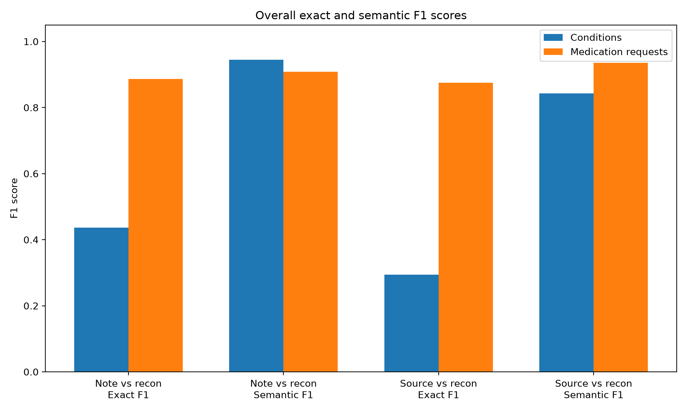

# BUPA : reconstruire un dossier médical à partir d'une note clinique

Un modèle de langage peut-il relire une note clinique rédigée en texte libre et retrouver les diagnostics et prescriptions du patient ? Et où se perd l'information en chemin ?

C'est la question de ce projet. Je pars de dossiers patients synthétiques au format FHIR ([Synthea](https://synthetichealth.github.io/synthea/)), je fais écrire une note clinique à **MedGemma** (`google/medgemma-4b-it`), puis je lui demande de reconstruire le dossier à partir de cette note seule. En comparant le résultat au dossier d'origine, on mesure ce qui a survécu.

Je me concentre sur deux types d'information : les **conditions** (diagnostics) et les **medication requests** (prescriptions).

## Comment ça marche

```text
dossier FHIR → filtrage → gold source → note générée → reconstruction → scoring → vérification → analyse des erreurs
```

1. **Filtrage** : je garde le patient, ses conditions et ses prescriptions, et j'écarte le bruit administratif ou social (emploi, logement…), d'abord par règles, puis avec le LLM.
2. **Gold source** : la version de référence du dossier, celle qu'on cherche à retrouver.
3. **Note générée** : MedGemma rédige une note dans l'un de quatre styles (consultation courte, antécédents médicaux, bilan de santé, note télégraphique) pour voir si la forme influence la reconstruction.
4. **Reconstruction** : MedGemma lit la note et renvoie un JSON structuré.
5. **Scoring** : on compare la reconstruction à la note et à la gold source, de deux façons. La comparaison **exacte** demande le même libellé. La comparaison **sémantique**, faite par le LLM, accepte qu'« anemia » corresponde à « Anemia (disorder) ».
6. **Vérification et analyse des erreurs** : un second passage du LLM juge la cohérence, et chaque erreur est classée selon l'étape où elle apparaît.

## Résultats

Benchmark sur **40 patients**, 10 par style de note.

| | Conditions | Medication requests |
|---|---:|---:|
| Note → reconstruction, F1 exact | 0.436 | 0.886 |
| Note → reconstruction, F1 sémantique | 0.945 | 0.909 |
| Source → reconstruction, F1 exact | 0.294 | 0.875 |
| Source → reconstruction, F1 sémantique | 0.843 | 0.936 |

La vérification juge **92,5 %** des reconstructions cohérentes, avec une confiance moyenne de 0.916.



Ce que j'en retiens :

- **Les prescriptions passent bien.** Leurs libellés (« Simvastatin 10 MG Oral Tablet ») sont recopiés tels quels, donc même le score exact est élevé.
- **Les conditions sont bien comprises mais reformulées.** Le score sémantique dépasse 0.94, alors que le score exact tombe à 0.44 : le modèle écrit « obesity » là où la source dit « Body mass index 30+ - obesity (finding) ». Ce n'est pas une erreur de fond.
- **L'information se perd surtout à l'écriture de la note.** Dans 15 cas sur 40, des conditions manquent déjà dans la note générée, avant même la reconstruction.
- **Les notes de consultation courtes restent les plus difficiles.** Le modèle y écrit plus librement (« je suspecte une bronchite… »), et le score sémantique source → reconstruction sur les conditions descend à 0.78.

Pour voir tout ça sur des cas concrets, regarde [les trois exemples patients](results/examples/) : un cas presque parfait, un cas de reformulation et un cas difficile.

## Installation

```bash
python -m venv .venv
# Windows : .venv\Scripts\activate    |    Linux/macOS : source .venv/bin/activate
pip install -r requirements.txt
cp .env.example .env           # puis y mettre ton HF_TOKEN
```

MedGemma est un modèle « gated » : il faut accepter ses conditions d'utilisation sur Hugging Face et fournir un token. Il faut aussi un GPU NVIDIA avec environ 10 Go de mémoire, ou Google Colab.

## Lancer le pipeline

Les trois notebooks se lancent dans l'ordre :

1. [`01_fhir_exploration`](notebooks/01_fhir_exploration.ipynb) : téléchargement de Synthea, préfiltrage, tirage de l'échantillon (sans GPU)
2. [`02_note_generation`](notebooks/02_note_generation.ipynb) : gold source, génération des notes, reconstruction
3. [`03_benchmark_results`](notebooks/03_benchmark_results.ipynb) : scores, vérification, analyse des erreurs, export

Chaque étape écrit ses sorties dans `data/` et les appels au modèle sont mis en cache : on peut s'arrêter et reprendre sans tout recalculer. La taille de l'échantillon se règle dans [`config/settings.py`](config/settings.py) (`N_PATIENTS`).

Sur un GPU de 16 Go (RTX 2000 Ada), le benchmark complet de 40 patients prend environ 1 h 15.

## Tests

```bash
pytest
```

Les tests utilisent un faux LLM : ils tournent en quelques secondes, sans GPU.

## Organisation du dépôt

```text
config/settings.py   tous les paramètres (chemins, modèle, plafonds, températures)
src/                 le pipeline, un module par étape
notebooks/           les trois notebooks à lancer
tests/               tests pytest
results/             résultats publiés du benchmark (CSV et exemples patients)
assets/figures/      figures
docs/                documentation détaillée
data/                données de travail, non versionnées
```

Pour aller plus loin : [vue d'ensemble](docs/project_overview.md) · [pipeline détaillée](docs/pipeline_explained.md) · [guide des notebooks](docs/notebook_guide.md) · [guide des résultats](docs/results_guide.md) · [carte du dépôt](docs/repository_map.md)

## Limites

- Les données sont synthétiques : de vraies notes cliniques seraient plus désordonnées.
- 40 patients, c'est assez pour voir des tendances, pas pour des conclusions statistiques solides.
- Le même modèle écrit les notes, les reconstruit et juge le résultat, ce qui peut le rendre indulgent envers lui-même. Le cas difficile des exemples en montre un : la vérification juge cohérente une reconstruction où il manque trois diagnostics.
- Le score exact sur les conditions est sévère et pénalise des reformulations correctes. Il faut le lire avec le score sémantique.
