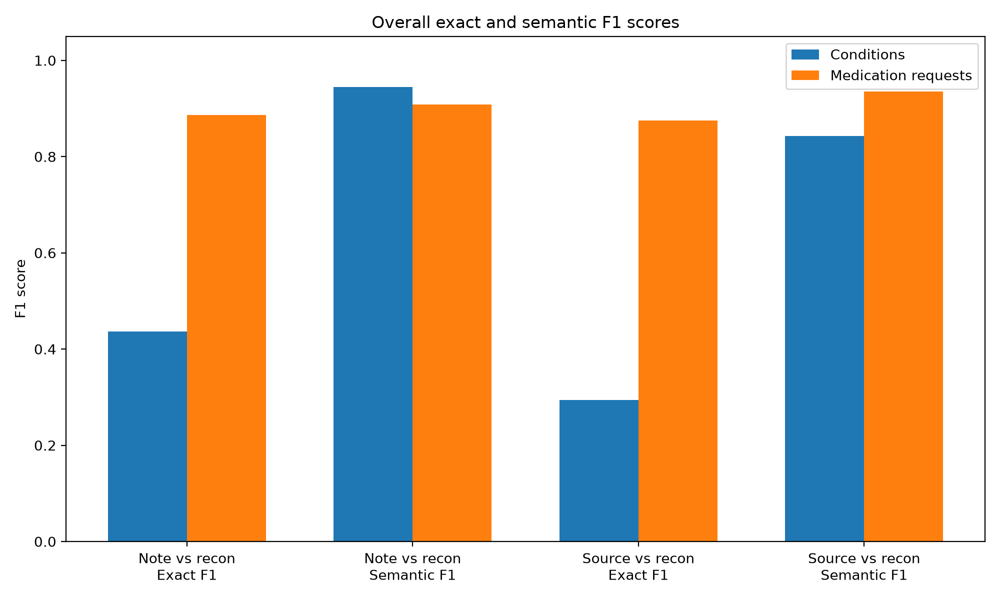
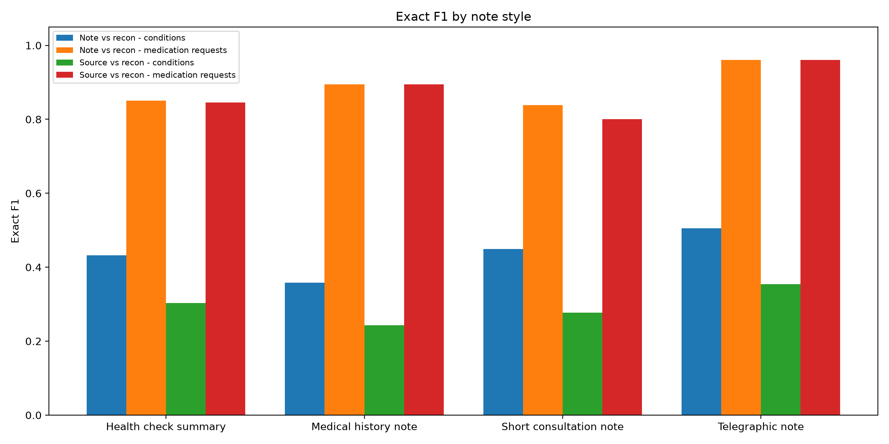
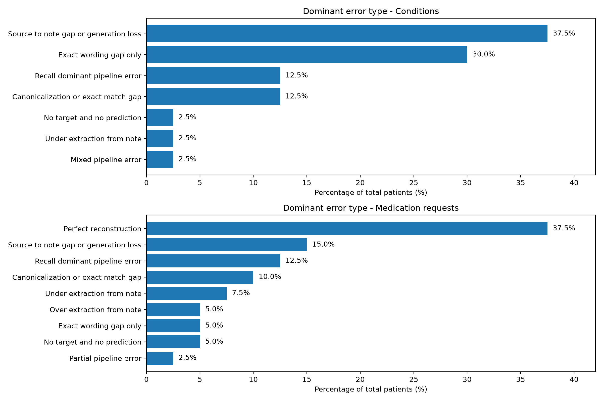
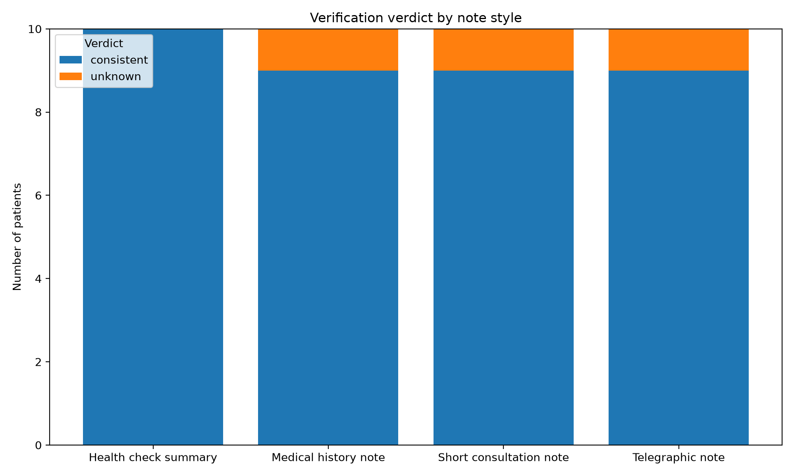

# Rapport du benchmark

40 patients tirés au hasard parmi les 555 dossiers Synthea (graine 155), 10 par style de note, modèle `google/medgemma-4b-it`.
Après filtrage, un patient compte en moyenne 6,9 conditions et 4,6 prescriptions à retrouver.

## Scores globaux

| | Conditions | Medication requests |
|---|---:|---:|
| Note → reconstruction, F1 exact | 0.436 | 0.886 |
| Note → reconstruction, F1 sémantique | 0.945 | 0.909 |
| Source → reconstruction, F1 exact | 0.294 | 0.875 |
| Source → reconstruction, F1 sémantique | 0.843 | 0.936 |

Les données démographiques extraites de la note sont justes dans 85 % des cas pour le nom, 75 % pour la date de naissance et 90 % pour le genre.

## Ce que montrent les chiffres

**Les prescriptions sont bien reconstruites, même au mot près.** Les libellés RxNorm (« Simvastatin 10 MG Oral Tablet ») sont trop techniques pour être reformulés : le modèle les recopie dans la note, puis de la note vers le JSON. Les scores exacts et sémantiques sont donc proches.

**Pour les conditions, il faut lire le score sémantique.** Le score exact sur les conditions plafonne à 0.44 (note) et 0.29 (source), alors que le score sémantique dépasse 0.84. L'écart vient des libellés SNOMED : « Anemia (disorder) » devient « anemia » dans la note, et « Body mass index 30+ - obesity (finding) » devient « Obesity ». Le sens est conservé, mais pas le libellé. L'analyse des erreurs classe 17 patients sur 40 dans cette catégorie (étape `canonicalization_exact_matching`).

**L'information se perd surtout à l'écriture de la note.** Pour les conditions, l'écart entre note → recon (0.945) et source → recon (0.843) montre qu'une partie du dossier n'arrive jamais dans la note. C'est l'étape fautive pour 15 patients sur 40, contre un seul pour lequel l'extraction depuis la note est en cause. Autrement dit, quand une information est écrite dans la note, MedGemma la retrouve presque toujours.

## Par style de note

| Style | Note → recon, cond. exact | Note → recon, cond. sém. | Source → recon, cond. sém. | Source → recon, méd. sém. | Vérif. « consistent » |
|---|---:|---:|---:|---:|---:|
| Health check summary | 0.432 | 0.927 | 0.885 | 0.918 | 10/10 |
| Medical history note | 0.358 | 0.974 | 0.920 | 0.895 | 9/10 |
| Short consultation note | 0.450 | 0.917 | 0.778 | 0.951 | 9/10 |
| Telegraphic note | 0.505 | 0.961 | 0.790 | 0.978 | 9/10 |

- Les **notes de consultation courtes** perdent le plus de conditions entre la source et la reconstruction (0.778). Le modèle y écrit comme un médecin : il présente certains diagnostics comme des hypothèses (« I suspect acute bronchitis »), que l'extraction écarte ensuite, et il en oublie d'autres pour garder la note courte. Le [patient 03](../results/examples/patient_03/) en est un exemple typique.
- Les **notes télégraphiques** ont le meilleur score exact : le modèle y recopie les libellés presque tels quels. Mais elles perdent aussi des conditions (0.790), parce que les fragments courts en laissent tomber.
- Les **notes d'antécédents** conservent le mieux les conditions (0.920), avec le score exact le plus bas : tout est là, mais reformulé en langage naturel ([patient 02](../results/examples/patient_02/)).

Avec 10 patients par style, un seul cas difficile déplace la moyenne de plusieurs points. Ces différences donnent une tendance, pas une conclusion ferme.

## Analyse des erreurs

| Étape fautive | Conditions | Medication requests |
|---|---:|---:|
| Aucune erreur | 1 | 17 |
| Reformulation seulement (`canonicalization_exact_matching`) | 17 | 6 |
| Perte à l'écriture de la note (`source_to_note`) | 15 | 6 |
| Erreur d'extraction depuis la note (`note_to_reconstruction`) | 1 | 5 |
| Erreurs à plusieurs étapes (`mixed`) | 6 | 6 |

Les règles de classement sont décrites dans `classify_error_type` ([src/evaluation.py](../src/evaluation.py)).

## Vérification

37 reconstructions sont jugées `consistent`, 3 `unknown` (le modèle n'a pas rendu de JSON exploitable) et aucune `minor_issues` ou `major_issues`.

Ce résultat est trop beau pour être pris tel quel. Dans 7 cas, le vérificateur répond `consistent` tout en listant lui-même des éléments manquants ou non justifiés. Pour le patient 03, il ne voit pas que trois diagnostics de la note manquent à la reconstruction. Le même modèle produit et juge : il se montre indulgent. La vérification sert surtout à repérer les cas que les scores signalent déjà, pas à les remplacer.

## Pistes d'amélioration

- **Utiliser le format de chat de Gemma.** Les prompts sont envoyés en texte brut. Le format attendu par le modèle donnerait probablement des notes plus fidèles, et un vérificateur plus strict.
- **Séparer le juge du modèle évalué.** Un modèle plus gros, ou différent, pour le matching sémantique et la vérification éviterait l'auto-indulgence.
- **Normaliser les libellés SNOMED** (retirer « (disorder) », « (finding) ») avant le score exact, pour qu'il mesure de vraies erreurs plutôt que des suffixes.
- **Plus de patients par style**, pour que les comparaisons entre styles soient solides.

## Fichiers

- [Scores globaux](../results/summaries/metrics/df_scores_overall_summary.csv) · [par style](../results/summaries/metrics/df_scores_summary_by_note_style.csv) · [par patient](../results/summaries/metrics/df_scores.csv)
- [Analyse des erreurs](../results/summaries/errors/df_error_analysis.csv) · [cas difficiles](../results/summaries/errors/df_hard_cases_by_note_style.csv)
- [Vérification](../results/summaries/verification/df_verification.csv)
